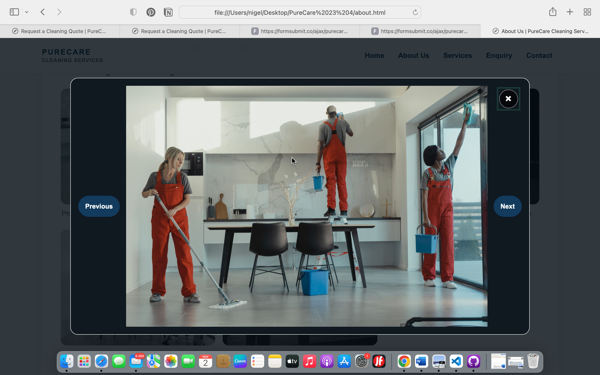
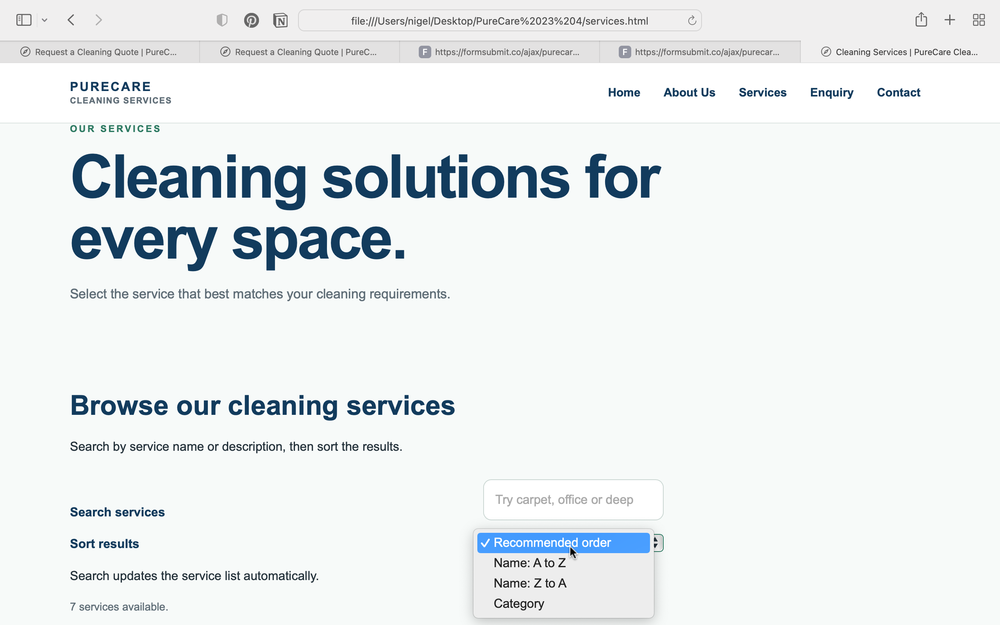
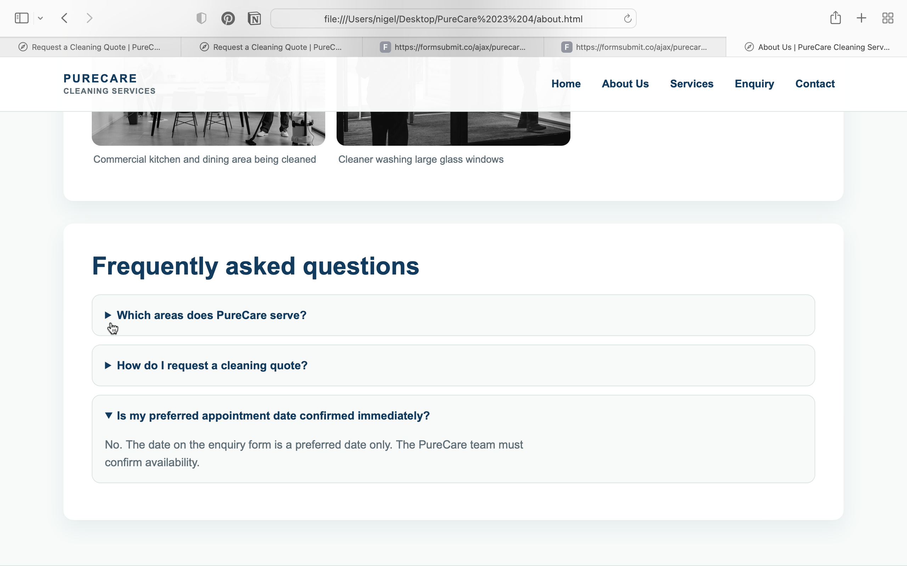
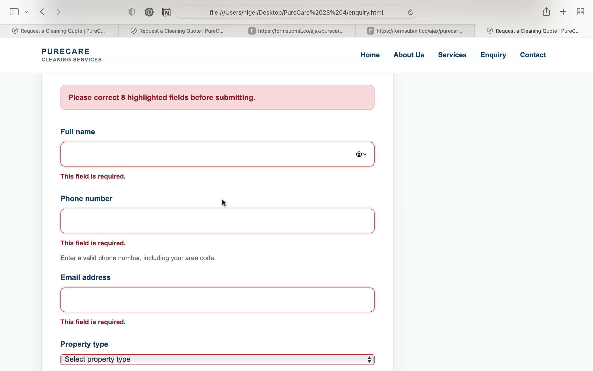
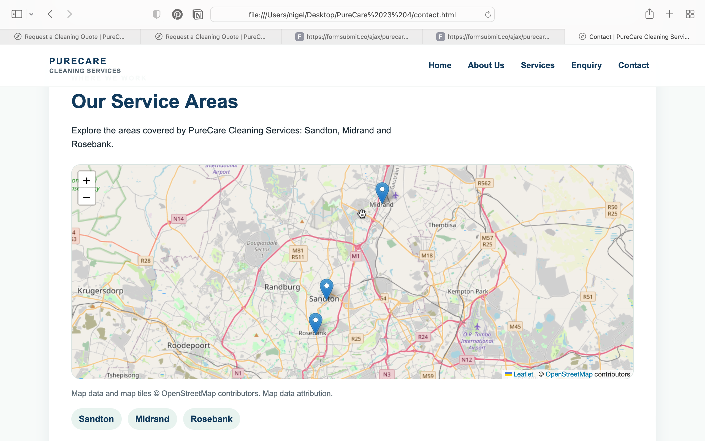

# PureCare Cleaning Services — WEDE5020 Portfolio of Evidence

## Student details
- **Student name:** Rethabile Pitse
- **Student number:** ST10516238
- **Module:** Web Development (Introduction) — WEDE5020
- **Project:** PureCare Cleaning Services
- **Project type:** Hypothetical small-business website

## Project overview

PureCare Cleaning Services is a hypothetical cleaning business offering residential, commercial and specialised cleaning services in Sandton, Midrand and Rosebank, Johannesburg. The website provides information about the organisation, describes its services, allows visitors to submit service enquiries and general messages, and displays its service areas.

The project was developed across the three POE parts: planning and HTML structure (Part 1), CSS styling and responsive design (Part 2), and JavaScript functionality, SEO and interactive features (Part 3). AI assistance from ChatGPT and Claude was used during development and is disclosed in the annexure (OpenAI, 2026; Anthropic, 2026).

---

# Part 1 — Project initiation and planning

## Project goal

The main goal is to create a functional, informative and visually consistent website that helps potential customers understand PureCare's cleaning services and contact the business easily.

## Objectives

1. Present clear information about PureCare and its residential, commercial and specialised cleaning services.
2. Make the website easy to navigate across five linked pages.
3. Give visitors a clear way to request a cleaning quote or submit a general message.
4. Communicate the service areas of Sandton, Midrand and Rosebank.
5. Provide a responsive experience on desktop, tablet and mobile devices.
6. Use accessible, semantic HTML and descriptive image text.
7. Add interactive features that improve service discovery and communication.

## Target audience

- Residents and households looking for regular, deep or move-related cleaning.
- Offices and small businesses requiring commercial cleaning.
- Customers needing specialised carpet, upholstery or post-renovation cleaning.
- People in Sandton, Midrand and Rosebank who want to enquire about service availability.

## Current situation and website rationale

The project treats PureCare as a small business that needs a central online place to explain its services and receive enquiries. Without a website, potential customers may have difficulty finding a consolidated service list, understanding the areas covered or knowing how to contact the business. The website addresses these needs through service pages, enquiry and contact forms, and an interactive service-area map.

This is a project scenario, not a claim that an existing PureCare business or analytics account was audited.

## Proposed success indicators (KPIs)

These are proposed targets for evaluating the website after it is published. They are not measured results.

| KPI | Proposed target | How it could be measured |
|---|---:|---|
| Successful enquiry submissions | At least 5 per month after launch | Count received enquiries |
| Contact form completion | At least 80% of visitors who start the form | Form-service records, if available |
| Mobile usability | No horizontal scrolling at common mobile widths | Manual responsive testing |
| Service discovery | Visitors can find a service using search and sorting | Functional test cases |
| Page performance | Optimised images and no unnecessary large originals | Browser performance audit |
| Navigation | All five pages reachable through the main navigation | Link testing |

## Proposed project timeline

| Phase | Work planned |
|---|---|
| Part 1 — Planning and structure | Select the organisation, define goals, plan page structure, prepare wireframes and build the HTML pages |
| Part 2 — Styling and responsiveness | Create the external stylesheet, establish visual design, implement responsive layouts and capture viewport screenshots |
| Part 3 — Functionality and publishing preparation | Add JavaScript interactions, form validation, map, SEO files, testing, documentation and deployment preparation |

## Website sitemap

```text
Home (index.html)
├── About Us (about.html)
│   ├── Image gallery and lightbox
│   └── Frequently asked questions
├── Services (services.html)
│   ├── Dynamic service catalogue
│   ├── Search
│   └── Sorting
├── Enquiry (enquiry.html)
│   └── Service quote / preferred-date request
└── Contact (contact.html)
    └── General contact form and service-area map
```

## Technical requirements and tools

- HTML5 for semantic page structure and forms.
- CSS3 for styling, responsive layouts and visual feedback.
- JavaScript for dynamic service rendering, sorting, search, form validation and asynchronous form submission, gallery interactions and map setup.
- Leaflet and OpenStreetMap for the interactive service-area map (Leaflet, n.d.; OpenStreetMap contributors, n.d.).
- GitHub for version control and repository hosting.
- GitHub Pages for static website hosting.
- Browser developer tools for responsive and functionality testing.

---

# Part 2 — CSS styling and responsive design

Part 2 builds on the HTML pages created in Part 1. The site uses an external stylesheet and responsive layouts to support desktop, tablet and mobile screen sizes.

## CSS styling implemented

- Created and linked `css/style.css` on all five HTML pages.
- Added a consistent colour scheme using CSS custom properties.
- Added a CSS reset and base styles.
- Added typography using font family, font size, font weight, line height and letter spacing.
- Used CSS Grid and Flexbox for page layouts.
- Added borders, rounded corners, shadows and spacing.
- Styled forms, buttons, service cards and content sections.
- Added hover, focus, focus-visible and active states.
- Added a reduced-motion media query.
- Used relative units such as `%`, `rem`, `clamp()` and flexible grid columns. Responsive layouts and media queries are based on standard CSS responsive-design techniques (Mozilla, n.d.-a; Mozilla, n.d.-b).

## Responsive design

- **Desktop:** full navigation, two-column hero and multi-column content.
- **Tablet:** reduced spacing and adjusted card layout.
- **Mobile:** single-column content, adjusted navigation, typography and form controls.

## Responsive images and performance

Responsive image variants are supplied at 800px and 1400px widths. The browser can select a suitable source through `srcset` and `sizes`. Images below the initial viewport use lazy loading, while the home hero image is prioritised. The five original image groups were renamed descriptively and compressed to reduce file size.

## Responsive testing evidence

The `screenshots/` folder contains the three responsive-design captures (`desktop-home.png`, `tablet-home.png` and `mobile-home.png`). It also contains separate Part 3 evidence for the gallery lightbox, service search and sorting, FAQ accordion, form validation errors and interactive map. The responsive captures document the page layouts, while the Part 3 captures document the added interactive features.

---

# Part 3 — JavaScript, interactivity, SEO and functionality

## Interactive elements

- **Dynamic service catalogue:** service cards are created from a JavaScript data array rather than being hard-coded in the page markup.
- **Search and sorting:** visitors can search services by name, category or description and sort by name or category.
- **Gallery lightbox:** selecting a gallery image opens a larger image viewer. Previous/next controls and keyboard arrow keys are supported; Escape closes the native dialog.
- **FAQ accordion:** native HTML `details` and `summary` elements allow visitors to expand and collapse answers.
- **Motion:** service cards use a short entrance animation, with reduced-motion preferences respected.

## Interactive map

A Leaflet map displays markers for Sandton, Midrand and Rosebank. The markers represent approximate area centres, not exact business premises or customer addresses. The map uses OpenStreetMap tiles and includes attribution (Leaflet, n.d.; OpenStreetMap contributors, n.d.). An internet connection is required for the external library and map tiles.

## Enquiry form

The service enquiry form requests the visitor's name, phone number, email, property type, service area, service required, preferred date and cleaning requirements.

- Required fields and input constraints are checked using the browser's form validity API.
- JavaScript displays custom inline error messages and focuses the first invalid field.
- Past preferred dates are prevented.
- A valid request produces an availability-related response showing the selected service area and requested date.
- The response clearly explains that the date is a request, not a confirmed booking, and that PureCare must review the requirements before confirming availability and a quote.

## Contact form

The general contact form requests a name, email address, message type and full message. JavaScript validates the fields and submits the message asynchronously to the configured Formspree endpoint. The on-page response indicates whether the submission succeeded or failed.

## Form submission

Both forms submit asynchronously using the Fetch API to separate Formspree endpoints:

- **Service enquiry:** `https://formspree.io/f/mdeepwjp`
- **General contact:** `https://formspree.io/f/mwllwrzo`

JavaScript validates the fields before submission and displays an on-page success or error message. An internet connection is required. Formspree is an external third-party service, so successful delivery also depends on the endpoints remaining active and any required Formspree account or email-verification settings being completed. Client-side validation improves the visitor experience but does not replace server-side validation (Mozilla, n.d.-c; OWASP, n.d.).

The enquiry form collects a preferred date as a request only. It does not confirm a booking or guarantee availability or a quote.

## Search engine optimisation (SEO)

### On-page SEO
- Each page has a unique title and meta description.
- Meta keywords are included to satisfy the assessment checklist.
- Headings use a logical page hierarchy.
- Images use descriptive filenames and alternative text.
- Internal navigation links connect the five pages.
- Local service-area wording refers to Sandton, Midrand and Rosebank.
- LocalBusiness structured data identifies the business name, email and service areas.

### Technical SEO
- Added `robots.txt` with a sitemap reference.
- Added `sitemap.xml` listing all five HTML pages.
- Kept the site mobile-responsive and reduced image sizes.
- Added descriptive Open Graph metadata.

### Off-page and local SEO plan
No backlinks or social-media campaigns have been created because no partner websites or official social-media account URLs were supplied. Recommended next steps are to create or verify the business's official local business profile, add links from genuine partner/community websites, and share the site through official social accounts once those accounts exist. Do not create fake reviews or artificial backlinks. Google Search Central recommends useful content and clear site structure as part of search visibility (Google, n.d.).

## Security and privacy

- Added a Content Security Policy meta tag restricting scripts, styles, images and other resources to the required sources.
- Added a strict referrer policy.
- External map resources use HTTPS and the Leaflet CDN links use Subresource Integrity.
- User-provided form content is placed into text fields and encoded into the email URL; dynamic service cards are built using DOM text nodes rather than inserting visitor input as HTML.
- The website does not collect passwords, payment details or sensitive personal information.
- A static front-end cannot provide server-side validation or protect a server endpoint because no backend is configured. A production form endpoint would need server-side validation, spam protection and secure data handling (OWASP, n.d.).

## Deployment and GitHub status

**Deployment status: published using GitHub Pages.** The repository's GitHub Pages source is configured to deploy from the `main` branch and the root folder (`/(root)`). The published website is available at:

`https://naynigel.github.io/PureCare-Cleaning-Services/`

GitHub Pages hosts the static website files from the configured repository source (GitHub, n.d.). The site URL above is the project's published address. The sitemap and `robots.txt` use this same project URL. Confirm that the live pages and interactive features continue to work after each future update.

## Project folder structure

```text
PureCare 23/
├── index.html
├── about.html
├── services.html
├── enquiry.html
├── contact.html
├── css/
│   └── style.css
├── js/
│   └── script.js
├── images/
│   ├── residential-cleaning-800.jpg
│   ├── residential-cleaning-1400.jpg
│   ├── commercial-floor-cleaning-800.jpg
│   ├── commercial-floor-cleaning-1400.jpg
│   ├── cleaning-team-800.jpg
│   ├── cleaning-team-1400.jpg
│   ├── commercial-kitchen-cleaning-800.jpg
│   ├── commercial-kitchen-cleaning-1400.jpg
│   ├── window-cleaning-800.jpg
│   └── window-cleaning-1400.jpg
├── screenshots/
├── robots.txt
├── sitemap.xml
├── IMAGE-CREDITS.md
├── AI-DISCLOSURE-ANNEXURE.md
├── DEPLOYMENT-NOTES.txt
└── README.md
```

## Testing checklist

- [x] Open all five pages and check the navigation.
- [x] Search for a service such as “carpet” and confirm matching results appear.
- [x] Change the sorting option and confirm the order changes.
- [x] Open the gallery lightbox, use previous/next, press Escape and test the close button.
- [x] Expand and collapse the FAQ items.
- [x] Test each form locally with empty fields and confirm inline validation errors appear (tested by the student).
- [x] Test valid enquiry and contact submissions locally using the configured Formspree forms (tested by the student).
- [x] Test both forms on the published HTTPS website and confirm that the form functionality works.
- [x] Test the map with an internet connection.
- [x] Check desktop, tablet and mobile layouts.
- [x] Include desktop, tablet and mobile responsive screenshots in `screenshots/` (the existing captures document the three viewport sizes).
- [x] Capture separate screenshots of the lightbox, accordion, service search/sort and custom form errors.
- [x] Confirm the sitemap URLs use the published GitHub Pages project URL.
- [x] Complete a final live-site check of all five pages and interactive features.
- [x] Confirm all image sources and licences in `IMAGE-CREDITS.md`.

## Feedback and revision record

### Part 1 feedback
No separate written lecturer-feedback document for Part 1 was included in the files available for this revision. No lecturer comments have been invented. The Part 1 goals, page structure and project documentation have been restored here as a project summary.

### Part 2 review feedback and actions
The review supplied for the Part 3 project identified the following issues. The actions below were added in this revision:

| Review point | Action recorded |
|---|---|
| Part 2 feedback and changelog were not documented clearly | Added this feedback and revision record and expanded the changelog |
| No gallery lightbox | Added an image gallery with a native dialog lightbox and navigation |
| Service content was hard-coded and no sorting existed | Added a JavaScript service data array, dynamic rendering, search and sorting |
| No meta keywords | Added a page-specific meta keywords tag to all five pages |
| Image filenames were generic | Renamed image variants descriptively |
| Forms used browser-only validation bubbles | Added custom inline field errors and an error summary |
| Enquiry response did not identify a specific request | Added a response containing the requested date, service and area, while clarifying that availability is not confirmed |
| README lacked Part 1 goals, KPIs, timeline and sitemap | Added these planning sections and a text sitemap |
| `sitemap.xml` was missing | Added `sitemap.xml` and a `Sitemap:` directive in `robots.txt` |
| Images were large and not lazy-loaded | Compressed responsive image variants and added lazy loading below the initial viewport |
| Security measures were not documented | Added a Content Security Policy and documented the limitations of static client-side security |
| Off-page and local SEO were not addressed | Added an honest plan; no backlinks or social profiles are claimed as completed |
| References were inconsistent and there were no in-text citations | Standardised the references in Harvard style and added in-text citations |
| Image credits and AI disclosure were missing | Added `IMAGE-CREDITS.md` and `AI-DISCLOSURE-ANNEXURE.md`; image source/licence details and required evidence screenshots still need to be completed |
| Deployment was not completed | Published the website through GitHub Pages from the `main` branch and root folder |

## Final review fixes (2 November 2026)

- Updated the enquiry phone field to accept South African national numbers (`0` followed by nine digits) and international numbers (`+27` followed by nine digits), with optional spaces or hyphens.
- Updated the inline phone validation message to explain the accepted South African formats.
- Updated the Content Security Policy `img-src` directive to allow Leaflet marker and marker-shadow images served from `unpkg.com`, as well as OpenStreetMap tiles.
- Removed duplicate HTML doctype declarations so each page has exactly one `<!DOCTYPE html>` at the beginning.
- The enquiry form records a preferred date as a request and does not display a cost estimate because no approved PureCare prices or pricing rules were supplied.
- Image source/licence details are documented in `IMAGE-CREDITS.md`.
- Four genuine AI conversation screenshots are included in `screenshots/` and listed in `AI-DISCLOSURE-ANNEXURE.md`.

## Changelog

### Part 1 — Planning and HTML structure
- Selected PureCare Cleaning Services as the hypothetical small-business project.
- Planned the five-page website structure and navigation.
- Created the Home, About Us, Services, Enquiry and Contact pages.
- Added the initial content, forms, images and wireframes.

### Part 2 — CSS styling and responsive design
- Created and linked the external `css/style.css` stylesheet.
- Added a consistent colour scheme, typography and base styles.
- Added CSS Grid and Flexbox layouts.
- Added desktop, tablet and mobile breakpoints.
- Improved navigation, forms, buttons, spacing and content cards.
- Added hover, focus and active states.
- Added responsive image sources and viewport screenshots.

### Part 3 — Functionality and SEO
- Added a JavaScript-driven service catalogue with search and sorting.
- Added an image gallery lightbox and FAQ accordion.
- Added custom inline validation to the enquiry and contact forms.
- Added preferred-date and service-area feedback to enquiry submissions.
- Connected the enquiry and contact forms to separate Formspree endpoints using asynchronous Fetch API submission.
- Added a Leaflet map for Sandton, Midrand and Rosebank.
- Added meta keywords, structured business data, robots.txt and sitemap.xml.
- Renamed and compressed image files and enabled lazy loading.
- Added a Content Security Policy and updated the README, references and disclosure documents.

---

## References (Harvard style)

GitHub (n.d.) *What is GitHub Pages?* GitHub Docs. Available at: https://docs.github.com/en/pages/getting-started-with-github-pages/what-is-github-pages (Accessed: 2 November 2026).

Google (n.d.) *SEO Starter Guide*. Google Search Central. Available at: https://developers.google.com/search/docs/fundamentals/seo-starter-guide (Accessed: 2 November 2026).

Leaflet (n.d.) *Leaflet — an open-source JavaScript library for mobile-friendly interactive maps*. Available at: https://leafletjs.com/ (Accessed: 2 November 2026).

Mozilla (n.d.-a) *Responsive design*. MDN Web Docs. Available at: https://developer.mozilla.org/en-US/docs/Learn_web_development/Core/CSS_layout/Responsive_Design (Accessed: 2 November 2026).

Mozilla (n.d.-b) *Media queries*. MDN Web Docs. Available at: https://developer.mozilla.org/en-US/docs/Web/CSS/CSS_media_queries/Using_media_queries (Accessed: 2 November 2026).

Mozilla (n.d.-c) *Constraint validation*. MDN Web Docs. Available at: https://developer.mozilla.org/en-US/docs/Web/HTML/Constraint_validation (Accessed: 2 November 2026).

OpenStreetMap contributors (n.d.) *Copyright and licence*. Available at: https://www.openstreetmap.org/copyright (Accessed: 2 November 2026).

Open Worldwide Application Security Project (OWASP) (n.d.) *Content Security Policy Cheat Sheet*. Available at: https://cheatsheetseries.owasp.org/cheatsheets/Content_Security_Policy_Cheat_Sheet.html (Accessed: 2 November 2026).

OpenAI (2026) *ChatGPT* [Large language model]. Available at: https://chatgpt.com/ (Accessed: 2 November 2026).

Anthropic (2026) *Claude* [Large language model, Sonnet 5.5]. Available at: https://claude.ai/ (Accessed: 2 November 2026).

## Image credits and AI disclosure

- Image source and licence information for the five image groups is documented in `IMAGE-CREDITS.md`.
- AI assistance is disclosed in `AI-DISCLOSURE-ANNEXURE.md`, with four genuine conversation screenshots stored in `screenshots/`.

## Repository and deployment

- **GitHub repository:** https://github.com/NayNigel/PureCare-Cleaning-Services
- **Live website:** https://naynigel.github.io/PureCare-Cleaning-Services/
- **Hosting:** GitHub Pages, deployed from `main` / `/(root)`.

## Suggested Git commit sequence

These are examples of descriptive commit messages for future changes. They are not evidence that these commits were created:
1. `Add Part 3 interactive service catalogue and sorting`
2. `Add gallery lightbox and FAQ accordion`
3. `Improve enquiry and contact form validation`
4. `Add service area map and local SEO metadata`
5. `Optimise images and add sitemap and security policy`
6. `Update README, changelog and project references`

These are suggested commit messages only. They are not evidence that commits have already been pushed.


## Form submission

The enquiry and contact forms submit asynchronously to separate Formspree endpoints using the Fetch API. The browser displays an on-page success or error message. Formspree is an external third-party service and requires an internet connection. The student has tested both forms locally; repeat the tests on the published website as part of final verification.


## Part 3 screenshots

The following screenshots document the interactive features added for Part 3:

| Feature | Evidence |
|---|---|
| Gallery lightbox |  |
| Services search and sorting |  |
| FAQ accordion |  |
| Form validation errors |  |
| Interactive service-area map |  |
